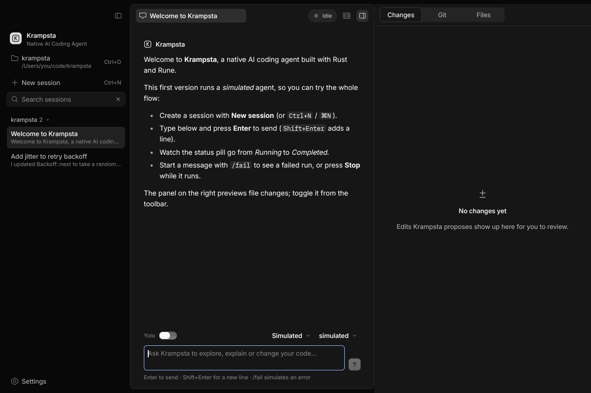
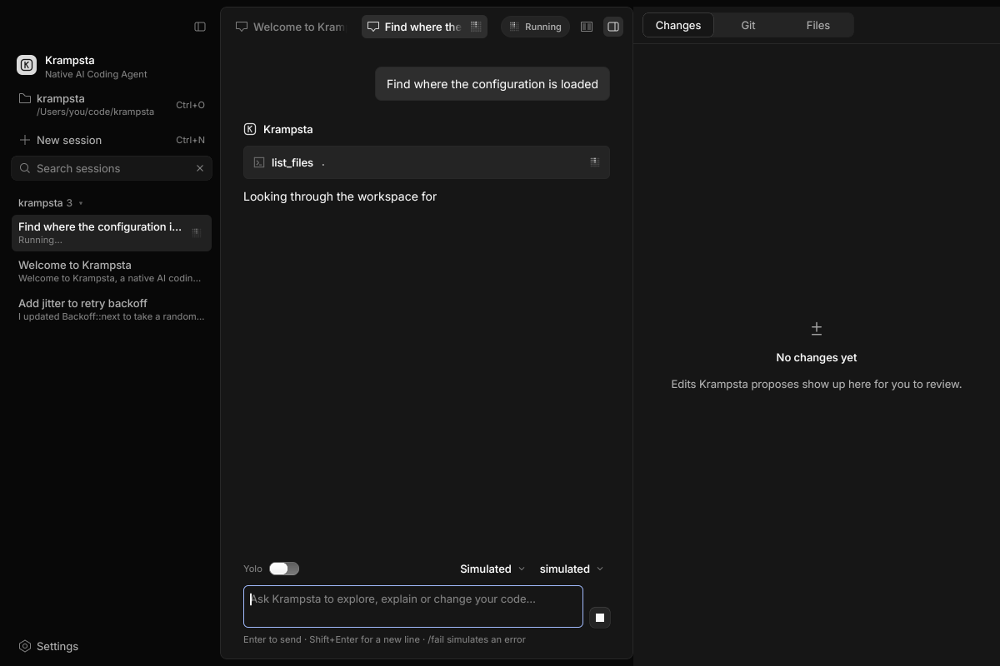
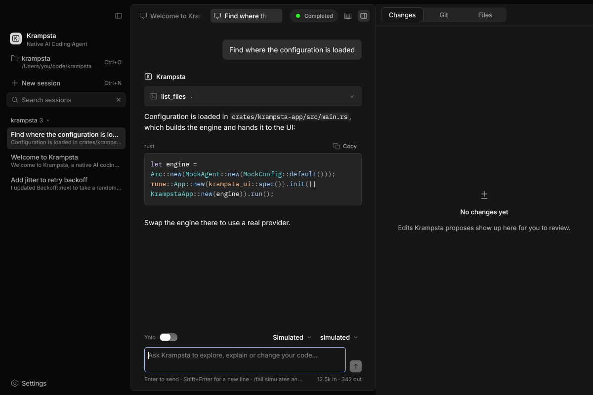
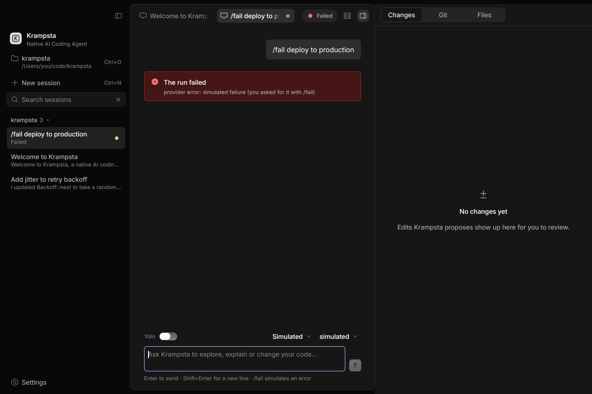

# Krampsta

**Native AI Coding Agent** — una aplicación de escritorio nativa, escrita en Rust y dibujada con
[Rune](https://github.com/anomalyco/rune), para trabajar con agentes de IA que exploran
repositorios, editan código y ejecutan herramientas.

Krampsta = **K**ristian + **Rune**. Sin Electron, sin Tauri, sin WebView, sin HTML/CSS: la interfaz
la renderiza Rune en la GPU (wgpu) en macOS, Windows y Linux.



> Estado: **bootstrap funcional (v0.1)** y primer proveedor real: OpenAI y servidores compatibles
> (llama.cpp, vLLM, Ollama…). Sin proveedor configurado, el agente es un `MockAgent` simulado (sin red).

## Qué hace hoy

- Ventana nativa de 1200×800, redimensionable (mínimo 760×520), tema oscuro por defecto: el
  tema **OpenCode** de Rune (`rune-theme-opencode`, el mismo de Rugents), con Inter e IBM Plex Mono.
- **Sidebar**: identidad de Krampsta, *New session*, lista de sesiones con la activa resaltada
  (spinner mientras corre, punto de aviso si falló) y acceso a *Settings*. Doble clic en una sesión
  (o «Rename» en su menú) la renombra en el sitio: Enter guarda, Escape cancela. El campo de
  búsqueda (`Ctrl+Shift+F`) filtra la lista por título y por el texto de los mensajes.
- **Panel principal**: título de la sesión, historial (usuario a la derecha, Krampsta a la
  izquierda con Markdown y bloques de código coloreados, cada uno con su botón **Copy**), indicador
  de estado del agente
  (`Idle`, `Running`, `Completed`, `Failed`, `Cancelled`) y *composer* que crece con el texto.
  Una imagen pegada (`Ctrl+V`, PNG de hasta 5 MiB y 24 megapíxeles) se adjunta al mensaje;
  sólo la envían los proveedores que leen imágenes (hoy, ChatGPT) y se guarda con el historial,
  como archivo aparte (`images/` junto a las sesiones).
- **Panel derecho**: los cambios que propone el agente, como diff (`rune-kit` `DiffView`): cada
  archivo se acepta o rechaza entero desde su cabecera, y cada bloque desde debajo;
  se oculta/muestra desde la barra (`Ctrl+J` / `⌘J`). Su cabecera cambia a **Git**: lo que difiere
  del último commit (preparado o no, y los archivos sin seguimiento), en un diff de sólo lectura
  que lee `git`; los binarios o los muy grandes sólo se nombran. Y a **Files**: el árbol
  de archivos del proyecto (`Tree` de rune-kit), como lo deja `.gitignore`, con un filtro y una marca
  en los archivos (y carpetas) con cambios propuestos; abrir un archivo (doble clic o Enter) añade
  su ruta al mensaje.
- **MockAgent**: al enviar un mensaje publica `Started`, «piensa», llama a una herramienta
  simulada (`list_files`), transmite la respuesta palabra a palabra y termina con `Completed`.
  Un mensaje que empieza por `/fail` simula un fallo; **Stop** cancela la ejecución.
- **Herramientas**: con un proveedor real, el agente lee el proyecto (la carpeta desde la que
  se abre Krampsta) con `list_files`, `search` y `read_file`, y cada llamada aparece como tarjeta
  plegable en el chat. Para cambiar código usa `edit_file`, que sólo **propone**: nada se
  escribe hasta que lo aceptas en el panel de cambios. Con `run_command` ejecuta comandos en esa
  carpeta (PowerShell en Windows, `sh` en el resto): la salida se ve en directo en la tarjeta, y
  cada comando pide permiso (una vez, siempre o denegar) salvo que lo cubra una regla de
  `permissions.json`, en la carpeta de configuración (`%APPDATA%\krampsta` en Windows). Lo que se
  ejecuta queda en `commands.log`. Leer un archivo de secretos (`.env`, claves `*.pem`, `id_rsa`,
  `credentials.json`…; no `.env.example`) también pide permiso, porque lo que dice llegaría al
  modelo, y `search` nunca mira dentro de ellos. Con `pending: true`, el agente puede ejecutar, por ejemplo,
  `cargo check` en una copia temporal con los cambios pendientes, sin aplicarlos. La copia incluye
  los archivos locales no ignorados y excluye `.git` y el `target` de la raíz. La copia se descarta
  al acabar, pero Cargo compila en una carpeta propia de la caché del usuario
  (`krampsta/check-target`), así que la siguiente comprobación no recompila las dependencias.
  Se aplican los mismos permisos: la copia temporal cambia la carpeta de trabajo del comando,
  pero **no** lo aísla del sistema. Los comandos no ven las claves de los proveedores de IA del
  entorno (`OPENAI_API_KEY` y similares), porque lo que escriben llega al modelo.
- **Modo yolo**: el interruptor «Yolo» sobre el composer lo activa en esa sesión, que lo recuerda
  entre arranques. Mientras está activo, lo que pediría permiso (comandos, herramientas MCP, leer
  un archivo de secretos) se permite sin preguntar, y los cambios de `edit_file` se escriben al
  momento, sin revisión; siguen viéndose en el chat y en el panel de cambios, y se deshacen con
  git. Las reglas `deny` de `permissions.json` siguen ganando, y `commands.log` apunta «yolo mode»
  como quien lo permitió. Un aviso bajo el composer recuerda que está activo.
- **Servidores MCP**: los de `mcp.json`, en la carpeta de configuración (`%APPDATA%\krampsta`
  en Windows), con el formato `mcpServers` de Claude Desktop, Claude Code o Cursor: un archivo
  de cualquiera de ellos sirve tal cual. Por stdio (`command`, `args`, `env`) o por HTTP
  (`"type": "http"`, `url`, `headers`); `"disabled": true` lo deja sin arrancar. Conectan en
  segundo plano al abrir Krampsta y sus herramientas, `mcp__<servidor>__<herramienta>`, entran en
  las ejecuciones siguientes, también sin carpeta abierta. Cada llamada sigue las reglas de
  herramientas de `permissions.json` (`"tools": {"allow": ["mcp__github__get_*"], "deny": […]}`:
  un nombre o un prefijo con `*`; `deny` gana) y, sin regla, pide permiso; «Always allow» guarda
  la regla para esa herramienta. Ajustes muestra cada servidor: conectado con sus herramientas,
  conectando, fallido con el motivo, o desactivado; desde ahí se añaden (comando o URL, con su
  entorno o sus cabeceras), se encienden y apagan y se quitan, al momento y sin reiniciar: el
  archivo se actualiza tocando sólo esa entrada. Un servidor por stdio sólo hereda las
  variables básicas del sistema más las suyas, nunca las claves de Krampsta.
  ```json
  {"mcpServers": {
    "everything": {"command": "npx", "args": ["-y", "@modelcontextprotocol/server-everything"]},
    "docs": {"type": "http", "url": "https://example.com/mcp", "headers": {"Authorization": "Bearer …"}}
  }}
  ```
- **Aviso en segundo plano**: si una ejecución termina o un comando pide permiso con la ventana
  detrás, el botón de la barra de tareas parpadea y cuenta las sesiones que te esperan (en macOS,
  el número sale en el Dock); al volver a la ventana se apaga.
- **Responsive**: al estrechar la ventana se pliegan los paneles laterales (primero el de
  cambios, después la sidebar) y vuelven a abrirse al ensancharla.
- Atajos: `Ctrl+N`/`⌘N` nueva sesión, `Ctrl+Shift+B`/`⇧⌘B` sidebar, `Ctrl+J`/`⌘J` cambios,
  `Ctrl+,`/`⌘,` ajustes, `Ctrl+Shift+F`/`⇧⌘F` buscar sesiones, `Enter` enviar, `Shift+Enter` nueva
  línea. `Ctrl+K`/`⌘K` abre la **paleta de comandos**: escribe parte del nombre de un comando o de
  una sesión; las flechas eligen, Enter lo ejecuta y Escape la cierra.

| Running | Completed | Failed |
| --- | --- | --- |
|  |  |  |
| **Settings** | **Light** | **Ventana estrecha** |
|  |  |  |

## Arquitectura

```text
krampsta/
├── Cargo.toml              workspace, Rune fijado a un commit + [patch.crates-io]
├── rust-toolchain.toml     1.99.1 (la misma que Rune)
├── crates/
│   ├── krampsta-core/         dominio puro: Session, Message, AgentStatus, AgentEvent, ToolCall…
│   ├── krampsta-agent/        contrato AgentEngine, AgentHost (runtime async) y MockAgent
│   ├── krampsta-providers/    motores reales: HTTP + SSE (reqwest) y OpenAI/compatibles
│   │   └── tests/          servidor HTTP falso que reproduce streams grabados
│   ├── krampsta-mcp/          cliente MCP (SDK `rmcp`): servidores por stdio y por HTTP
│   ├── krampsta-store/        historial: cada sesión en un JSON, escrito en un hilo propio
│   ├── krampsta-tools/        herramientas del agente: read_file, list_files, search, edit_file,
│   │                       run_command, y las reglas de permisos
│   ├── krampsta-ui/           estado de la UI, tema, vistas y componentes Rune/rune-kit
│   │   └── tests/ui.rs     pruebas de interacción con el Runtime headless de Rune
│   └── krampsta-app/          binario `krampsta`: elige el motor y arranca la app
├── scripts/                snapshots.sh, send-message.json (script headless)
└── assets/screenshots/     capturas de referencia generadas headless
```

```text
krampsta-app ──▶ krampsta-ui ─────────▶ krampsta-agent ──▶ krampsta-core
krampsta-app ──▶ krampsta-providers ──▶ krampsta-agent
krampsta-app ──▶ krampsta-tools ──────▶ krampsta-agent
krampsta-app ──▶ krampsta-store ──────▶ krampsta-agent
       (krampsta-ui, krampsta-providers y krampsta-store también usan krampsta-core)
          (Rune y rune-kit sólo en krampsta-ui y krampsta-app)
```

- **krampsta-core** no depende de Rune ni de ningún proveedor. `Session::apply(&AgentEvent)` es la
  máquina de estados que pliega los eventos de una ejecución en la sesión; los eventos de una
  ejecución obsoleta (p. ej. una cancelada que sigue hablando) se ignoran.
- **krampsta-agent** define `AgentEngine` (objeto `Arc<dyn AgentEngine>`, futuro `Send`),
  `RunContext` (emitir texto/herramientas, token de cancelación, `sleep` cancelable) y
  `AgentHost`, que posee un runtime **tokio** creado perezosamente, lanza ejecuciones, garantiza
  `Started` + exactamente un evento terminal (incluso si el motor hace *panic*) y entrega los
  eventos por un canal más un `Notifier` (`Arc<dyn Fn() + Send + Sync>`).
- **krampsta-ui**: `KrampstaApp` es todo el estado. En `AppSpec::setup` el `Waker` de Rune se instala
  como notificador; cuando llega un evento, Rune ejecuta `poll`, que llama a `KrampstaApp::pump`.
  El hilo gráfico nunca bloquea y las vistas son funciones puras del estado (sin I/O).
- **krampsta-app** sólo cablea: `rune::App::new(krampsta_ui::spec()).init(|| KrampstaApp::new(catalog()))`,
  con el `Catalog` de `krampsta-providers`. La UI sólo conoce el contrato `EngineCatalog` de
  `krampsta-agent`: lista los proveedores, pide sus modelos en segundo plano y cambia de motor.
- **krampsta-providers**: `sse` (parser incremental de `text/event-stream`), `http` (petición
  cancelable: cancelar suelta la respuesta y cierra la conexión; errores legibles para 401/403,
  429, red y *timeouts*), `OpenAiEngine` (Chat Completions con streaming), `list_models`
  (`GET /models`) y `Catalog`. Cada motor hace el bucle del agente: pide, ejecuta las
  herramientas que pida el modelo (a la vez si son varias) y le devuelve los resultados, hasta
  una respuesta sin llamadas (tope de 50 pasos).
- **krampsta-tools**: `Workspace` implementa el `Toolbox` de `krampsta-agent` sobre la carpeta
  del proyecto, con los crates de ripgrep: recorrido que respeta `.gitignore` y búsqueda en
  paralelo con detección de binarios. Cada herramienta lee sólo lo necesario, pone tope a su
  salida y se detiene al cancelar. Peor caso medido (764 MB, 31 495 archivos, sin
  coincidencias): ~340 ms, a la par que `rg`.
- **krampsta-mcp**: cliente MCP sobre el SDK oficial (`rmcp`). `McpClient::connect` arranca un
  servidor como proceso (stdio; árbol que se mata entero, sin consola, y el final de su stderr
  explica por qué no arrancó) o lo alcanza por Streamable HTTP (cabeceras y token Bearer);
  `tools` lista sus herramientas y `call` las llama, cancelable y con la respuesta recortada.
  `config` lee `mcp.json`; `McpServers` los conecta en segundo plano y `ToolSet` junta sus
  herramientas con las del proyecto en el registro del agente.
- **krampsta-store**: `FileStore` implementa el `SessionStore` de `krampsta-agent`. Guarda cada
  sesión en `<carpeta de datos>/krampsta/sessions/<id>.json` (en Windows, `%APPDATA%`). La UI
  sólo encola; un hilo escribe, junta los guardados repetidos de una sesión y renombra un
  temporal sobre el archivo para que un cierre a medias no lo corrompa. Se guarda al enviar, al
  terminar cada herramienta y al acabar la ejecución, nunca por palabra. Las ejecuciones
  headless no guardan nada. Al arrancar, `setup` pide el historial (`SessionStore::load`); el
  mismo hilo lo lee y despierta la ventana, y `poll` pone las sesiones guardadas bajo las
  abiertas: el primer frame no espera al disco. Los ajustes (`Prefs` de la UI) van a
  `<carpeta de configuración>/krampsta/settings.json` por el mismo hilo; se leen antes del primer
  frame (un archivo pequeño) para que la ventana abra como se dejó.

## Requisitos

- Rust **1.99.1** (lo instala `rustup` automáticamente gracias a `rust-toolchain.toml`).
- Git.
- **Windows**: toolchain MSVC (`x86_64-pc-windows-msvc`, la de rustup por defecto) con las
  *Visual Studio C++ Build Tools*. Con la toolchain GNU hacen falta las binutils de MinGW-w64
  (ver el README de Rune).
- **macOS**: Xcode Command Line Tools.
- **Linux**: `libxkbcommon-dev libwayland-dev` para compilar (Debian/Ubuntu); para ventanas,
  `libxkbcommon-x11-0`, y sin GPU física un driver Vulkan por software (`mesa-vulkan-drivers`).
  Las capturas `--snap` no necesitan display.

## Instalación y ejecución

```bash
git clone <este repositorio> krampsta && cd krampsta
cargo run -p krampsta-app             # abre la ventana (binario: target/debug/krampsta)
cargo run -p krampsta-app -- ~/code/x  # con ~/code/x como proyecto (sin argumento: la carpeta actual;
                                      # en la app, la fila del proyecto o Ctrl+O abre otra)
cargo run -p krampsta-app --release   # versión optimizada
```

La primera compilación descarga y compila Rune (varios minutos).

### Elegir el proveedor

El proveedor y el modelo se eligen dentro de la app, bajo el composer o en *Settings*. Los
modelos se leen del propio servidor (`GET /v1/models`). Los proveedores disponibles son:

| Proveedor | Servidor | Necesita |
| --- | --- | --- |
| OpenAI | `https://api.openai.com/v1` | una clave: *Settings › API keys*, o `OPENAI_API_KEY` |
| ChatGPT | el backend de Codex de tu cuenta (API Responses) | tu plan de ChatGPT: *Settings › Accounts › Sign in* |
| GitHub Copilot | la API de Copilot de tu cuenta | tu suscripción: *Settings › Accounts › Sign in* |
| OpenAI-compatible | `OPENAI_BASE_URL` (sólo aparece si está definida) | `OPENAI_API_KEY`, si el servidor la pide |
| llama.cpp | `http://127.0.0.1:9931/v1` (el puerto de `llama-menu.bat`; otro con `LLAMA_CPP_URL`) | `llama-server` en marcha |
| Ollama | `http://localhost:11434/v1` | Ollama en marcha |
| LM Studio | `http://localhost:1234/v1` | el servidor de LM Studio en marcha |
| Simulated | el `MockAgent` | nada |

Las claves nunca van al repositorio. La de OpenAI se guarda desde *Settings › API keys* en el
llavero del sistema (entrada `openai-api-key`) y manda sobre `OPENAI_API_KEY`; sin clave guardada
se usa la variable. Las demás se leen del entorno. Las cuentas (ChatGPT, Copilot) se inician en la app
con un código de dispositivo: Krampsta muestra el código, abre la página y guarda la sesión en el
llavero del sistema (Administrador de credenciales en Windows). Elegir en el selector un proveedor
de cuenta sin sesión abre el inicio de sesión. Para elegir lo que sale seleccionado al
abrir: `KRAMPSTA_PROVIDER` (`openai`, `chatgpt`, `copilot`, `custom`, `llamacpp`, `ollama`, `lmstudio` o `mock`) y
`KRAMPSTA_MODEL`. Con llama.cpp el desplegable muestra el nombre del `.gguf` cargado.
Sin nada definido, arranca con el simulado. Con Ollama, por ejemplo:

```bash
ollama pull qwen3:4b
cargo run -p krampsta-app        # y elige Ollama › qwen3:4b bajo el composer
```

## Tests y comprobaciones

```bash
cargo fmt --all -- --check
cargo check --workspace --all-targets
cargo clippy --workspace --all-targets -- -D warnings
cargo test --workspace
```

Si estás modificando Krampsta desde la propia app, ejecuta `cargo self-test` desde la raíz.
Compila y prueba el workspace en `target/self-test`, sin reemplazar el ejecutable de desarrollo
abierto desde `target/debug`. Aplica antes los cambios que quieras probar: Cargo solo lee el disco.
Si solo quieres compilar la app o probar las herramientas, usa un destino alternativo:

```bash
cargo build -p krampsta-app --target-dir target/validation
cargo test -p krampsta-tools --target-dir target/validation
```

- `krampsta-core`: transiciones de sesión (envío, streaming, fallo, cancelación, eventos obsoletos).
- `krampsta-agent`: el host enmarca cada ejecución, convierte errores y *panics* en `Failed`,
  notifica cada evento; el mock llama herramientas, falla con `/fail` y se cancela rápido.
- `krampsta-providers`: parser SSE (eventos partidos, UTF-8 a medias, `
`), errores HTTP y, contra
  un servidor falso, streaming grabado, 401, 429, error dentro del stream, servidor caído y que
  cancelar cierra la conexión.
- `krampsta-ui` (unitarias): enviar/recibir con el mock real, plegado responsive de paneles y el
  selector (lista de modelos que llega, primer modelo, recordar el último, servidor caído, sin clave).
- `krampsta-ui/tests/ui.rs`: la vista real en el `Runtime` headless de Rune, con clics y teclado:
  componentes presentes, crear/seleccionar sesiones, escribir en el composer, Enter y botón de
  enviar, estados running → completed/failed/cancelled, panel de cambios, ajustes y que el
  layout no se salga de la ventana ni se solape a 760×520, 1000×700, 1200×800 y 1680×1050.

## Capturas headless y árbol de elementos

Las builds de depuración aceptan siempre las herramientas de Rune; en release, compila con
`--features tooling`.

```bash
cargo run -p krampsta-app -- --snap krampsta.png --size 1200x800 --scale 1
cargo run -p krampsta-app -- --tree krampsta-tree.json
cargo run -p krampsta-app -- --list-scenes
cargo run -p krampsta-app -- --snap running.png --scene running        # escenas deterministas
cargo run -p krampsta-app -- --script scripts/send-message.json --snap send.png --at mark:end
cargo run -p krampsta-app --release --features tooling -- --snap krampsta.png
bash scripts/snapshots.sh            # regenera assets/screenshots/
```

Escenas: `light`, `empty`, `draft`, `running`, `completed`, `failed`, `cancelled`, `settings`,
`changes-hidden`, `sidebar-hidden`, `provider-picker`, `model-picker`, `model-error`, `signed-in`,
`sign-in`. Para tamaños estrechos usa `--at 1.0`: los paneles se pliegan
tras el primer layout. Todos los elementos importantes tienen claves estables con el prefijo
`krampsta-` (ver `crates/krampsta-ui/src/keys.rs`), útiles en scripts (`"key": "krampsta-composer"`) y
en el árbol JSON.

## Actualizar Rune de forma segura

Rune es pre-release: se fija **un único commit** de la rama `dev` (que nunca se reescribe).
Commit actual: **`c8424ac797a2a7097a3530607c9ecadef37deec6`**.

1. `git ls-remote https://github.com/anomalyco/rune refs/heads/dev` → nuevo SHA.
2. Lee el `Cargo.toml` raíz de Rune **en ese SHA**: la tabla `[patch.crates-io]` (hoy `winit`,
   `parley_engine`, `wgpu-hal`, `naga`, `sctk-adwaita`, `accesskit_windows`, `accesskit_macos` y
   `accesskit_atspi_common`) y su `rust-toolchain.toml`.
3. En el `Cargo.toml` de Krampsta sustituye el SHA en `rune`, `rune-kit` **y en cada parche**
   (todos iguales); añade o quita parches según la lista de Rune. Cargo no hereda los
   `[patch]` de una dependencia. Ajusta `rust-toolchain.toml` si Rune cambió de versión.
4. Revisa el `CHANGELOG.md` de Rune por cambios incompatibles.
5. `cargo update -p rune -p rune-kit`. Si Cargo avisa de un parche «not used in the crate graph»,
   el `Cargo.lock` tiene una versión más nueva de crates.io: fíjala a la del parche
   (`cargo update -p naga@<lock> --precise <parche>`). Después todas las comprobaciones de arriba más
   `bash scripts/snapshots.sh`; compara las capturas con las anteriores.
6. Versiona `Cargo.lock` junto al cambio.

## Próximos hitos

1. **Proveedores reales** detrás de `AgentEngine` (hecho): OpenAI y compatibles, ChatGPT y GitHub
   Copilot, clave de OpenAI en el llavero, selector de modelo y esfuerzo, tokens por sesión.
   Anthropic y Google, aplazados (sólo admiten clave de API, sin cuenta).
2. **Herramientas**: lectura de archivos, búsqueda, edición con diff propuesto → aceptado en el
   panel de cambios; ejecución de comandos con **sistema de permisos** y sandbox.
3. **Persistencia** de sesiones (fuera del hilo gráfico) y apertura de un proyecto/carpeta.
4. **MCP**: cliente de servidores MCP como fuente de herramientas.
5. Árbol de archivos del proyecto (`rune-kit` `Tree`/`FileTree`), panel de diff real con
   `git diff`, renombrar/borrar sesiones, búsqueda, menú contextual.
6. Indexación de repositorios grandes, empaquetado e instaladores por plataforma.

## Licencia

MIT.
