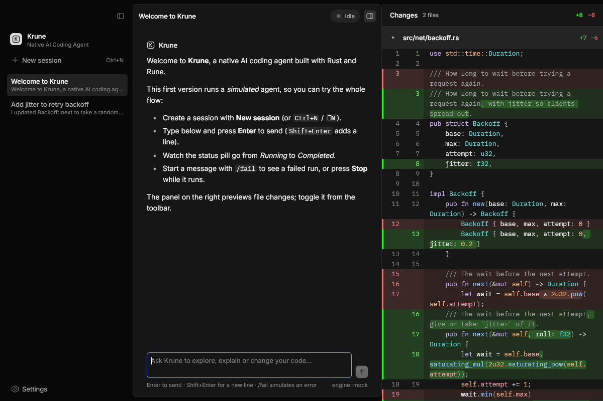
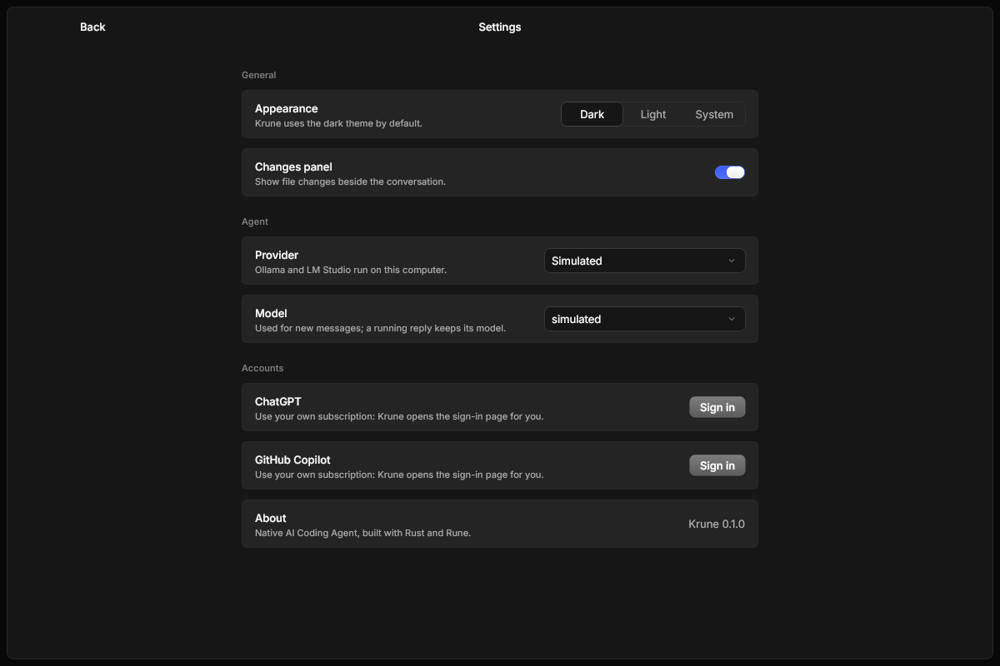
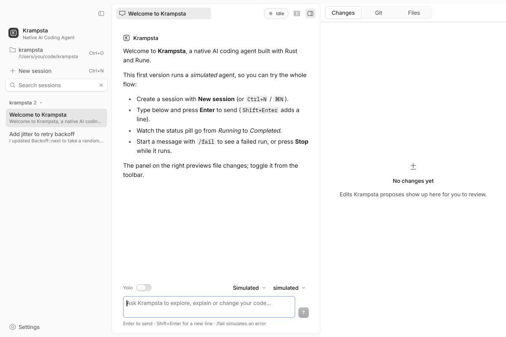
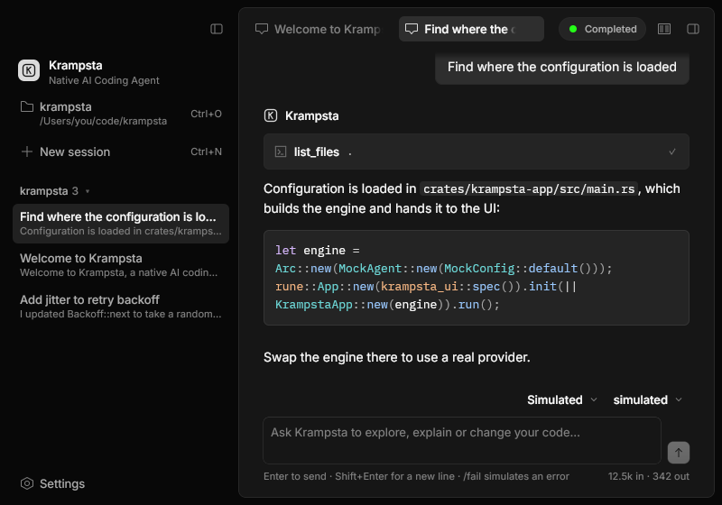

# Krune

**Native AI Coding Agent** — una aplicación de escritorio nativa, escrita en Rust y dibujada con
[Rune](https://github.com/anomalyco/rune), para trabajar con agentes de IA que exploran
repositorios, editan código y ejecutan herramientas.

Krune = **K**ristian + **Rune**. Sin Electron, sin Tauri, sin WebView, sin HTML/CSS: la interfaz
la renderiza Rune en la GPU (wgpu) en macOS, Windows y Linux.



> Estado: **bootstrap funcional (v0.1)** y primer proveedor real: OpenAI y servidores compatibles
> (llama.cpp, vLLM, Ollama…). Sin proveedor configurado, el agente es un `MockAgent` simulado (sin red).

## Qué hace hoy

- Ventana nativa de 1200×800, redimensionable (mínimo 760×520), tema oscuro por defecto: el
  tema **OpenCode** de Rune (`rune-theme-opencode`, el mismo de Rugents), con Inter e IBM Plex Mono.
- **Sidebar**: identidad de Krune, *New session*, lista de sesiones con la activa resaltada
  (spinner mientras corre, punto de aviso si falló) y acceso a *Settings*.
- **Panel principal**: título de la sesión, historial (usuario a la derecha, Krune a la
  izquierda con Markdown y bloques de código coloreados), indicador de estado del agente
  (`Idle`, `Running`, `Completed`, `Failed`, `Cancelled`) y *composer* que crece con el texto.
- **Panel derecho**: vista de diferencias (`rune-kit` `DiffView`) con datos de ejemplo;
  se oculta/muestra desde la barra (`Ctrl+J` / `⌘J`).
- **MockAgent**: al enviar un mensaje publica `Started`, «piensa», llama a una herramienta
  simulada (`list_files`), transmite la respuesta palabra a palabra y termina con `Completed`.
  Un mensaje que empieza por `/fail` simula un fallo; **Stop** cancela la ejecución.
- **Responsive**: al estrechar la ventana se pliegan los paneles laterales (primero el de
  cambios, después la sidebar) y vuelven a abrirse al ensancharla.
- Atajos: `Ctrl+N`/`⌘N` nueva sesión, `Ctrl+Shift+B`/`⇧⌘B` sidebar, `Ctrl+J`/`⌘J` cambios,
  `Ctrl+,`/`⌘,` ajustes, `Enter` enviar, `Shift+Enter` nueva línea.

| Running | Completed | Failed |
| --- | --- | --- |
|  |  |  |
| **Settings** | **Light** | **Ventana estrecha** |
|  |  |  |

## Arquitectura

```text
krune/
├── Cargo.toml              workspace, Rune fijado a un commit + [patch.crates-io]
├── rust-toolchain.toml     1.99.1 (la misma que Rune)
├── crates/
│   ├── krune-core/         dominio puro: Session, Message, AgentStatus, AgentEvent, ToolCall…
│   ├── krune-agent/        contrato AgentEngine, AgentHost (runtime async) y MockAgent
│   ├── krune-providers/    motores reales: HTTP + SSE (reqwest) y OpenAI/compatibles
│   │   └── tests/          servidor HTTP falso que reproduce streams grabados
│   ├── krune-ui/           estado de la UI, tema, vistas y componentes Rune/rune-kit
│   │   └── tests/ui.rs     pruebas de interacción con el Runtime headless de Rune
│   └── krune-app/          binario `krune`: elige el motor y arranca la app
├── scripts/                snapshots.sh, send-message.json (script headless)
└── assets/screenshots/     capturas de referencia generadas headless
```

```text
krune-app ──▶ krune-ui ─────────▶ krune-agent ──▶ krune-core
krune-app ──▶ krune-providers ──▶ krune-agent
       (krune-ui y krune-providers también usan krune-core)
          (Rune y rune-kit sólo en krune-ui y krune-app)
```

- **krune-core** no depende de Rune ni de ningún proveedor. `Session::apply(&AgentEvent)` es la
  máquina de estados que pliega los eventos de una ejecución en la sesión; los eventos de una
  ejecución obsoleta (p. ej. una cancelada que sigue hablando) se ignoran.
- **krune-agent** define `AgentEngine` (objeto `Arc<dyn AgentEngine>`, futuro `Send`),
  `RunContext` (emitir texto/herramientas, token de cancelación, `sleep` cancelable) y
  `AgentHost`, que posee un runtime **tokio** creado perezosamente, lanza ejecuciones, garantiza
  `Started` + exactamente un evento terminal (incluso si el motor hace *panic*) y entrega los
  eventos por un canal más un `Notifier` (`Arc<dyn Fn() + Send + Sync>`).
- **krune-ui**: `KruneApp` es todo el estado. En `AppSpec::setup` el `Waker` de Rune se instala
  como notificador; cuando llega un evento, Rune ejecuta `poll`, que llama a `KruneApp::pump`.
  El hilo gráfico nunca bloquea y las vistas son funciones puras del estado (sin I/O).
- **krune-app** sólo cablea: `rune::App::new(krune_ui::spec()).init(|| KruneApp::new(catalog()))`,
  con el `Catalog` de `krune-providers`. La UI sólo conoce el contrato `EngineCatalog` de
  `krune-agent`: lista los proveedores, pide sus modelos en segundo plano y cambia de motor.
- **krune-providers**: `sse` (parser incremental de `text/event-stream`), `http` (petición
  cancelable: cancelar suelta la respuesta y cierra la conexión; errores legibles para 401/403,
  429, red y *timeouts*), `OpenAiEngine` (Chat Completions con streaming), `list_models`
  (`GET /models`) y `Catalog`.

## Requisitos

- Rust **1.99.1** (lo instala `rustup` automáticamente gracias a `rust-toolchain.toml`).
- Git.
- **Windows**: toolchain MSVC (`x86_64-pc-windows-msvc`, la de rustup por defecto) con las
  *Visual Studio C++ Build Tools*. Con la toolchain GNU hacen falta las binutils de MinGW-w64
  (ver el README de Rune).
- **macOS**: Xcode Command Line Tools.
- **Linux**: `libxkbcommon-dev libwayland-dev` para compilar (Debian/Ubuntu); para ventanas,
  `libxkbcommon-x11-0`, y sin GPU física un driver Vulkan por software (`mesa-vulkan-drivers`).
  Las capturas `--snap` no necesitan display.

## Instalación y ejecución

```bash
git clone <este repositorio> krune && cd krune
cargo run -p krune-app             # abre la ventana (binario: target/debug/krune)
cargo run -p krune-app --release   # versión optimizada
```

La primera compilación descarga y compila Rune (varios minutos).

### Elegir el proveedor

El proveedor y el modelo se eligen dentro de la app, bajo el composer o en *Settings*. Los
modelos se leen del propio servidor (`GET /v1/models`). Los proveedores disponibles son:

| Proveedor | Servidor | Necesita |
| --- | --- | --- |
| OpenAI | `https://api.openai.com/v1` | `OPENAI_API_KEY` |
| ChatGPT | el backend de Codex de tu cuenta (API Responses) | tu plan de ChatGPT: *Settings › Accounts › Sign in* |
| GitHub Copilot | la API de Copilot de tu cuenta | tu suscripción: *Settings › Accounts › Sign in* |
| OpenAI-compatible | `OPENAI_BASE_URL` (sólo aparece si está definida) | `OPENAI_API_KEY`, si el servidor la pide |
| llama.cpp | `http://127.0.0.1:9931/v1` (el puerto de `llama-menu.bat`; otro con `LLAMA_CPP_URL`) | `llama-server` en marcha |
| Ollama | `http://localhost:11434/v1` | Ollama en marcha |
| LM Studio | `http://localhost:1234/v1` | el servidor de LM Studio en marcha |
| Simulated | el `MockAgent` | nada |

Las claves se leen del entorno, nunca del repositorio. Las cuentas (ChatGPT, Copilot) se inician en la app
con un código de dispositivo: Krune muestra el código, abre la página y guarda la sesión en el
llavero del sistema (Administrador de credenciales en Windows). Elegir en el selector un proveedor
de cuenta sin sesión abre el inicio de sesión. Para elegir lo que sale seleccionado al
abrir: `KRUNE_PROVIDER` (`openai`, `chatgpt`, `copilot`, `custom`, `llamacpp`, `ollama`, `lmstudio` o `mock`) y
`KRUNE_MODEL`. Con llama.cpp el desplegable muestra el nombre del `.gguf` cargado.
Sin nada definido, arranca con el simulado. Con Ollama, por ejemplo:

```bash
ollama pull qwen3:4b
cargo run -p krune-app        # y elige Ollama › qwen3:4b bajo el composer
```

## Tests y comprobaciones

```bash
cargo fmt --all -- --check
cargo check --workspace --all-targets
cargo clippy --workspace --all-targets -- -D warnings
cargo test --workspace
```

- `krune-core`: transiciones de sesión (envío, streaming, fallo, cancelación, eventos obsoletos).
- `krune-agent`: el host enmarca cada ejecución, convierte errores y *panics* en `Failed`,
  notifica cada evento; el mock llama herramientas, falla con `/fail` y se cancela rápido.
- `krune-providers`: parser SSE (eventos partidos, UTF-8 a medias, `
`), errores HTTP y, contra
  un servidor falso, streaming grabado, 401, 429, error dentro del stream, servidor caído y que
  cancelar cierra la conexión.
- `krune-ui` (unitarias): enviar/recibir con el mock real, plegado responsive de paneles y el
  selector (lista de modelos que llega, primer modelo, recordar el último, servidor caído, sin clave).
- `krune-ui/tests/ui.rs`: la vista real en el `Runtime` headless de Rune, con clics y teclado:
  componentes presentes, crear/seleccionar sesiones, escribir en el composer, Enter y botón de
  enviar, estados running → completed/failed/cancelled, panel de cambios, ajustes y que el
  layout no se salga de la ventana ni se solape a 760×520, 1000×700, 1200×800 y 1680×1050.

## Capturas headless y árbol de elementos

Las builds de depuración aceptan siempre las herramientas de Rune; en release, compila con
`--features tooling`.

```bash
cargo run -p krune-app -- --snap krune.png --size 1200x800 --scale 1
cargo run -p krune-app -- --tree krune-tree.json
cargo run -p krune-app -- --list-scenes
cargo run -p krune-app -- --snap running.png --scene running        # escenas deterministas
cargo run -p krune-app -- --script scripts/send-message.json --snap send.png --at mark:end
cargo run -p krune-app --release --features tooling -- --snap krune.png
bash scripts/snapshots.sh            # regenera assets/screenshots/
```

Escenas: `light`, `empty`, `draft`, `running`, `completed`, `failed`, `cancelled`, `settings`,
`changes-hidden`, `sidebar-hidden`, `provider-picker`, `model-picker`, `model-error`, `signed-in`,
`sign-in`. Para tamaños estrechos usa `--at 1.0`: los paneles se pliegan
tras el primer layout. Todos los elementos importantes tienen claves estables con el prefijo
`krune-` (ver `crates/krune-ui/src/keys.rs`), útiles en scripts (`"key": "krune-composer"`) y
en el árbol JSON.

## Actualizar Rune de forma segura

Rune es pre-release: se fija **un único commit** de la rama `dev` (que nunca se reescribe).
Commit actual: **`47eaa86eba751687597d0aaf6ee325baeecd4666`**.

1. `git ls-remote https://github.com/anomalyco/rune refs/heads/dev` → nuevo SHA.
2. Lee el `Cargo.toml` raíz de Rune **en ese SHA**: la tabla `[patch.crates-io]` (hoy `winit`,
   `parley_engine`, `wgpu-hal`, `accesskit_windows`, `accesskit_macos`) y su `rust-toolchain.toml`.
3. En el `Cargo.toml` de Krune sustituye el SHA en `rune`, `rune-kit` **y en cada parche**
   (todos iguales); añade o quita parches según la lista de Rune. Cargo no hereda los
   `[patch]` de una dependencia. Ajusta `rust-toolchain.toml` si Rune cambió de versión.
4. Revisa el `CHANGELOG.md` de Rune por cambios incompatibles.
5. `cargo update -p rune -p rune-kit`, y después todas las comprobaciones de arriba más
   `bash scripts/snapshots.sh`; compara las capturas con las anteriores.
6. Versiona `Cargo.lock` junto al cambio.

## Próximos hitos

1. **Proveedores reales** detrás de `AgentEngine`: OpenAI y compatibles (hecho), GitHub Copilot,
   Anthropic y Google; claves desde el llavero del sistema, selector de modelo y coste por sesión.
2. **Herramientas**: lectura de archivos, búsqueda, edición con diff propuesto → aceptado en el
   panel de cambios; ejecución de comandos con **sistema de permisos** y sandbox.
3. **Persistencia** de sesiones (fuera del hilo gráfico) y apertura de un proyecto/carpeta.
4. **MCP**: cliente de servidores MCP como fuente de herramientas.
5. Árbol de archivos del proyecto (`rune-kit` `Tree`/`FileTree`), panel de diff real con
   `git diff`, renombrar/borrar sesiones, búsqueda, menú contextual.
6. Indexación de repositorios grandes, empaquetado e instaladores por plataforma.

## Licencia

MIT.
